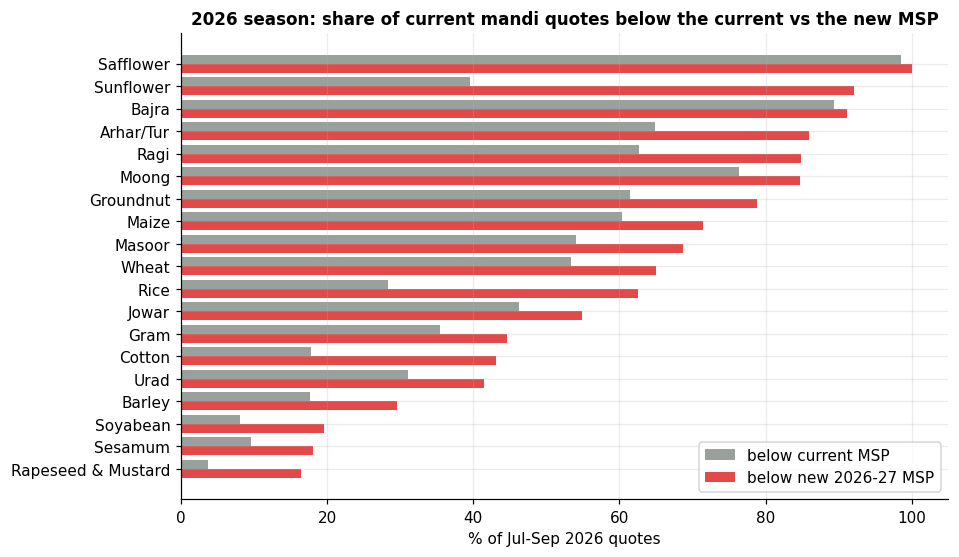
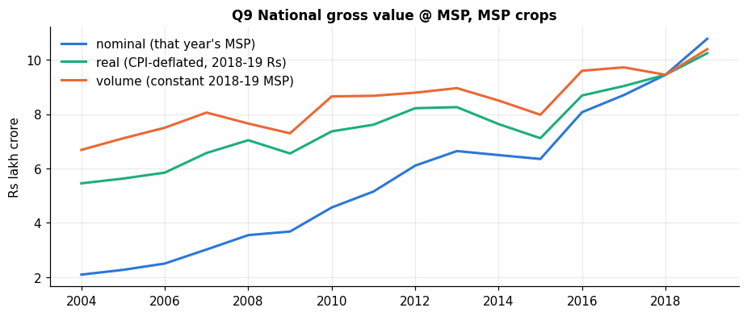
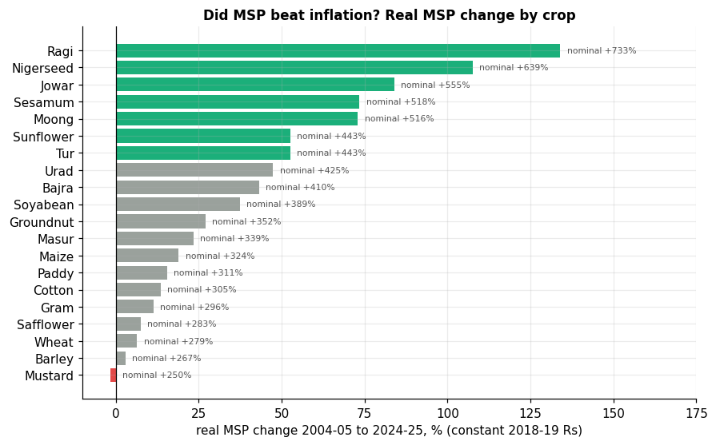
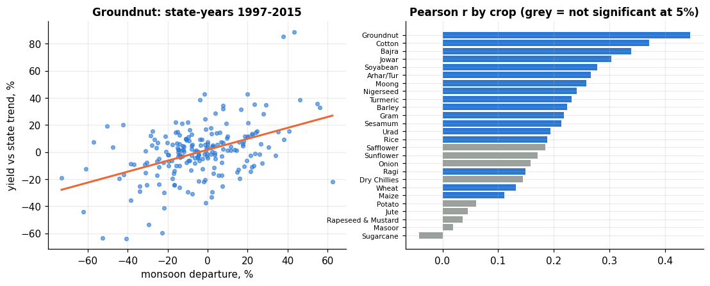

# Farmer Revenue Intelligence

**End-to-end agricultural analytics on official Indian data: Python, SQL (SQLite) and Power BI. It analyses crop production, MSP, mandi prices, cost of cultivation, rainfall and inflation to estimate the gross value of Indian crops and test how market prices compare with MSP, including the 2026 season.**

**Main question:** *How do production, MSP, mandi prices, costs, rainfall and inflation shape the economic value of Indian crops, and how do farmers' market prices compare with the support price?*

`Python · pandas · NumPy · SciPy` &nbsp;|&nbsp; `SQL · SQLite (star schema, CTEs, window functions)` &nbsp;|&nbsp; `Power BI · DAX · Power Query (PBIP)` &nbsp;|&nbsp; `Matplotlib · Jupyter` &nbsp;|&nbsp; `pytest`

> **Read this first:** *gross value* = production × MSP, an **estimate** at the support price. It is **not**
> what farmers were actually paid and **not farmer income or profit**: it ignores labour, fertiliser, seed,
> irrigation, machinery, transport, land rent and interest. Profit is estimated only where official DES cost data exist.
> Rainfall results are associations, not causes. Details: [`docs/METHODOLOGY.md`](docs/METHODOLOGY.md).

| 2026 season: quotes below current vs new MSP | Value over time: nominal vs real vs volume |
|---|---|
|  |  |
| **Did MSP beat inflation? Real MSP change by crop** | **Rainfall vs yield (association only)** |
|  |  |

Power BI report (8 pages): [`power_bi/pbip/FarmerRevenueIntelligence.pbip`](power_bi/pbip). Screenshots go in [`docs/screenshots/`](docs/screenshots).

## The story in five areas

```text
        PRODUCTION              PRICES & MSP               WEATHER
   DES district crop data   MSP 2002-03..2026-27      IMD rainfall 1901-2015
   (units standardised)     AGMARKNET mandi prices    (state = mean of subdivisions)
            │                         │                          │
            └──────────── SQLite star schema (6 dims, 8 facts) ──┘
                                      │
                         REVENUE: gross value = production × MSP
                         + CPI inflation adjustment + DES cost → profit
                                      │
                         2026 OUTLOOK: mandi prices vs current and new MSP
                                      │
                         Power BI (8 pages) → business insights
```

| Area | Question it answers | Where |
|---|---|---|
| Production | How much is produced, where, and how fast is it growing (YoY, CAGR, yield)? | Notebook 02, Power BI p3 and p8, SQL q11/q13 |
| Prices & MSP | How do mandi prices compare with MSP? Did MSP rise faster than inflation? | Notebook 03/05, Power BI p4, SQL q06/q12 |
| Revenue | Which crops and states create the most estimated gross value, and where does MSP cover cost? | Notebook 05, Power BI p1–p3, SQL q01–q04 |
| Weather | Is seasonal rainfall associated with yield? | Notebook 05, Power BI p5, SQL q07 |
| 2026 outlook | How do current mandi prices compare with the newly announced MSPs? | Notebook 05, Power BI p7, SQL q15 |

## Key findings

- **Most of the value growth is price, not output.** MSP-valued gross output rose **×4.5** in nominal terms from 2004-05 to 2018-19 (₹2.09 → ₹9.45 lakh crore), **×1.73 after inflation** (CPI) and only **×1.41 in volume** (constant 2018-19 MSPs).
- **After inflation, MSP rises were very uneven.** From 2004-05 to 2024-25 the real MSP of **wheat rose only 6%, paddy 15%, and mustard fell 2%**, while millets and pulses rose sharply (**ragi +134%, jowar +84%, moong +73%**). This matches the policy push for crop diversification.
- **Two crops dominate.** Rice and wheat are **53%** of MSP-valued output (2014-15 to 2018-19). The top five crops (adding sugarcane, cotton and gram) are 76%.
- **At MSP, many crops don't cover full cost.** In DES-surveyed states (2008-09 to 2013-14), valuing output at MSP leaves a loss over C2 (full cost including imputed rent and interest) in **73% of rice, 77% of maize and 90% of cotton** state-years. Most crops still cover paid-out cost plus family labour (A2+FL). Sugarcane is the exception (+₹13k/ha over C2).
- **Mandi prices often sit below MSP.** AGMARKNET, 21-Jul to 24-Sep-2026: **89% of bajra, 76% of moong and 65% of tur** quotes were below MSP. Mustard (4%) and soyabean (8%) traded mostly above it.
- **2026 season: the new MSPs raise the bar.** KMS 2026-27 (13-May-2026) and RMS 2027-28 (30-Sep-2026) raised MSPs by 0.1% (moong) to 10% (safflower). At current prices, **91% of bajra, 86% of tur, 85% of moong and 63% of paddy** quotes are below the new MSP; for paddy that is up from 28% below the current one. These are pre-harvest prices, so read them as a benchmark.
- **Rainfed crops move with the monsoon; irrigated ones don't.** Detrended yield vs seasonal rainfall (state-years 1997-2015): groundnut r = 0.45, cotton 0.37, bajra 0.34, wheat only 0.13. Higher rainfall was *associated* with higher yields; this does not establish causation.
- **Units matter.** APY reports milled rice and lint cotton; MSP is for paddy and kapas. Converting changes rice value by ×1.49 and cotton by ×2.9 versus naive multiplication.

## Data quality

<!-- DQ:START -->
```text
DATA QUALITY  (auto-generated by src/dq_report.py)
✓ Foreign-key violations                                                           0
✓ Duplicate production keys (district x crop x year x season)                      0
✓ Duplicate district x crop x year rows                                            0
✓ Duplicate MSP crop x year                                                        0
✓ Duplicate mandi quotes (dataset x market x crop x date x variety)                0
✓ Missing crop_id in fact tables                                                   0
✓ Negative area or production                                                      0
✓ Non-positive modal prices left in analysis                                       0
✓ Mandi quotes excluded (<=0 or >5x / <1/5 of median)                              310
✓ Quotes flagged: min/modal/max inconsistent                                       464
✓ MSP rows without a positive value or source URL                                  0
✓ MSP values from official releases                                                98.4%
✓ Conversion factors: rice -> paddy, lint bale -> kapas, tonnes -> quintals        rice x14.93, cotton x5.0, others x10
✓ MSP compared with a non-comparable price form (milled rice, lint, dal...)        0
✓ SQL q07_rain_yield_correlation vs pandas q07a_rain_yield_association (pearson_r) max diff 0.000 over 26
✓ SQL q12_real_msp_vs_inflation vs pandas q09c_real_msp_by_crop (real_growth_pct)  max diff 0.000 over 20
✓ SQL q15_season_2026_outlook vs pandas q11g_season_2026_outlook (pct_below_next_msp) max diff 0.000 over 19
✓ District sums vs DES 3rd advance estimates 2019-20 (within 10%)                  4/8
✓ Automated pipeline tests (pytest tests/)                                         15
```
Details: [`docs/DATA_QUALITY.md`](docs/DATA_QUALITY.md)
<!-- DQ:END -->

## Business questions and answers

Full tables in `outputs/results/`, charts in `notebooks/05`, SQL versions in `sql/analysis_queries.sql`.

| # | Question | Answer (window) |
|---|---|---|
| 1 | Which crops generate the highest estimated gross value? | Rice ₹2.48 lakh cr/yr (32%), wheat ₹1.67 lakh cr (21%), sugarcane ₹0.89 lakh cr (11%), then cotton and gram (2014-18 avg, at MSP) |
| 2 | Which crops have the highest estimated profit per ha? | Over C2: sugarcane ₹13.2k/ha, mustard ₹3.5k, wheat ₹2.2k. Rice, maize, pulses, groundnut and cotton are negative over C2 at MSP but mostly positive over A2+FL (2008-13, surveyed states only) |
| 3 | Which states and districts have the strongest crop economics? | Value/ha: Punjab ₹83k, Tamil Nadu ₹68k, Haryana ₹68k. Top districts: the western-UP sugarcane belt (Muzaffarnagar, Meerut ≈ ₹1.46 lakh/ha) and Kolhapur |
| 4 | How does yield affect revenue? | At a uniform MSP, value/ha differences are yield differences. Top-quartile-yield districts earn 2.3–5.6× the value/ha of bottom-quartile ones. For the major crops, 66–81% of value growth from 2004-06 to 2016-18 came from MSP increases and only 9–23% from yield |
| 5 | How much do mandi prices differ across markets? | Jul–Sep 2026, same day: median cross-market price variation (CV) potato 68%, onion 30%, maize 23%, urad 23%. Moong is cheapest in Rajasthan (₹6,690/qtl) and dearest in Kerala (₹12,300) |
| 6 | Which crops frequently trade below MSP? | Jul–Sep 2026: bajra 89%, moong 76%, tur 65%, groundnut 62%, maize 60%, wheat 53% of quotes below MSP. Tur improved from 75% below MSP in July to 48% in September |
| 7 | How does the 2026 market compare with the latest MSP? | New MSPs: paddy ₹2,441 (+3.0%), tur ₹8,450 (+5.6%), cotton ₹8,267 (+7.2%), wheat ₹2,610 (+1.0%), mustard ₹6,613 (+6.7%). Below the new MSP: bajra 91%, tur 86%, moong 85%, ragi 85%, groundnut 79%, maize 71%, wheat 65%, paddy 63%; soyabean 20%, mustard 16% |
| 8 | Is rainfall associated with production? | Positive, significant associations for rainfed kharif crops (groundnut r = 0.45, cotton 0.37, bajra 0.34). Weak for irrigated wheat (0.13), none for sugarcane or mustard |
| 9 | Which crops combine high production with low profitability? | Rice, maize and cotton combine large area with negative C2 margins at MSP. Soyabean and maize have large area but low value/ha |
| 10 | How has value changed over time, and did MSP beat inflation? | ₹2.09 → ₹9.45 lakh cr (2004-05 → 2018-19): ×4.5 nominal, ×1.73 real, ×1.41 volume. Real MSP 2004-05 → 2024-25: wheat +6%, paddy +15%, mustard −2%, ragi +134% |
| 11 | Which states grew production fastest? | 2018-19 vs 2017-18 rice: Madhya Pradesh +23%, Maharashtra +20%, Karnataka +19%, Odisha +18% (SQL q11) |
| 12 | Which markets are most volatile? | Jul–Sep 2026: onion (median market CV 22%; Keelpennathur TN 36%, Sriganganagar RJ 35%). Maharashtra APMCs 2014-16: monthly onion CV 67% |

## Power BI report

`power_bi/pbip/FarmerRevenueIntelligence.pbip` is generated by `power_bi/build_pbip.py` (TMDL model, 81 DAX measures, PBIR report). Open it in Power BI Desktop and click **Refresh**.

| Page | Purpose |
|---|---|
| 1 Executive Overview | KPIs (gross value, YoY, CAGR, area, crops, districts, % of 2026 quotes below MSP), nominal vs real vs volume trend, crop mix, state value/ha |
| 2 Crop Revenue & Profitability | Value by crop, value/ha, footprint vs value, profit where DES cost exists, growth decomposition |
| 3 State & District Analysis | State ranking, state × crop group matrix, top districts, yield trends |
| 4 Mandi Price Intelligence | Price vs MSP by month, **MSP nominal vs real (CPI) vs cost**, % below MSP, MSP-vs-mandi table (gap coloured), volatile markets |
| 5 Weather & Yield | Rain departure vs yield anomaly scatter, r by crop, monsoon categories |
| 6 Data Quality | Validation, issues and handling, sources, MSP provenance |
| 7 Season 2026 | Crop slicer → current MSP, new MSP, median mandi price, % below each, markets; daily price vs both MSPs; **price distribution** by distance from MSP; all-crop outlook; new MSP table |
| 8 Crop Explorer | Pick crop, states and years → production, YoY, yield, gross value, real MSP change, % below MSP, rain–yield r; production and yield trend; state ranking; YoY table with conditional colours |

## Quick start

```bash
pip install -r requirements.txt
python run_pipeline.py            # ~40 s: MSP -> facts -> SQLite -> analytics -> SQL -> data-quality report -> Power BI data
python -m pytest -q tests         # 15 integrity / methodology / SQL-vs-Python / loader tests
python -m src.sql_queries         # run the 15 SQL analysis queries only
python power_bi/build_pbip.py     # regenerate the Power BI project
jupyter lab notebooks/            # step-by-step walkthrough (executed, outputs saved)
```

The database (`database/`), the processed tables (`data/processed/`) and the Power BI data (`power_bi/data/`) are generated, not committed: run `python run_pipeline.py` once after cloning, before opening the notebooks or the Power BI project.

**Adding newer production years (2020-21 onward).** Download district-wise crop production from [data.desagri.gov.in](https://data.desagri.gov.in) or [UPAg](https://upag.gov.in) as CSV, save it as `data/raw/apy_district_extra_2020_2023.csv` and run `python run_pipeline.py`. The loader maps the column names, converts "2020-21" style years, rejects rows whose production unit doesn't match the crop (e.g. bales vs tonnes), and only uses a year if enough districts report it. Every table, chart, SQL result and document then updates automatically.

## Data model (star schema)

```text
             dim_crop        dim_year (crop year, CPI deflator)       dim_date
                 │                     │                                  │
dim_state ── fact_production ─ fact_district_crop_year ─ fact_state_crop_year
    │                                  │                                  │
dim_location (district)          fact_msp (MSP, real MSP, cost)     fact_market_price ── dim_market
                                       │
             fact_cost_of_cultivation · fact_weather_state · fact_weather_subdivision
             dq_issues · dq_coverage · dq_validation · ref_sources
```

Facts hold measurements at one grain each (district × crop × year, market × crop × day, crop × year); dimensions hold the descriptive attributes they are sliced by. This keeps SQL joins simple and maps directly onto Power BI relationships. Column-level definitions and units: [`docs/DATA_DICTIONARY.md`](docs/DATA_DICTIONARY.md).

## SQL highlights

[`sql/analysis_queries.sql`](sql/analysis_queries.sql) has 15 queries covering filtering, GROUP BY / HAVING, INNER and LEFT JOIN, CASE, CTEs and window functions (RANK, DENSE_RANK, ROW_NUMBER, NTILE, LAG, FIRST_VALUE, SUM OVER, rolling AVG). Tests check that the SQL answers match the pandas ones.

**Which states had the highest YoY production growth? (LAG per partition, HAVING, RANK, CASE)**
```sql
WITH state_year AS (
    SELECT c.crop_name, s.state_name, f.crop_year,
           SUM(f.production_apy_unit) AS production_t, SUM(f.area_ha) AS area_ha
    FROM fact_district_crop_year f
    JOIN dim_crop c     ON c.crop_id = f.crop_id
    JOIN dim_location l ON l.location_id = f.location_id
    JOIN dim_state s    ON s.state_id = l.state_id
    WHERE c.crop_name IN ('Rice', 'Wheat') AND f.crop_year BETWEEN 2016 AND 2018
    GROUP BY c.crop_name, s.state_name, f.crop_year
    HAVING SUM(f.area_ha) >= 100000
),
with_lag AS (
    SELECT *, LAG(production_t) OVER (PARTITION BY crop_name, state_name ORDER BY crop_year) AS prev_production_t
    FROM state_year
)
SELECT crop_name, state_name,
       ROUND(100.0 * (production_t / prev_production_t - 1), 1) AS yoy_growth_pct,
       RANK() OVER (PARTITION BY crop_name ORDER BY production_t / prev_production_t DESC) AS growth_rank,
       CASE WHEN production_t >= prev_production_t * 1.10 THEN 'strong growth (>=10%)'
            WHEN production_t >= prev_production_t        THEN 'growth'
            ELSE 'decline' END AS trend
FROM with_lag
WHERE crop_year = 2018 AND prev_production_t > 0;
```

**Nominal vs real vs volume over time (LAG, FIRST_VALUE, named window)**
```sql
WITH yearly AS (
    SELECT crop_year,
           SUM(gross_value_msp_inr) / 1e7         AS nominal_cr,
           SUM(gross_value_real_2018_inr) / 1e7   AS real_cr,
           SUM(gross_value_at_2018_msp_inr) / 1e7 AS volume_cr
    FROM fact_district_crop_year
    WHERE gross_value_msp_inr IS NOT NULL
    GROUP BY crop_year
)
SELECT crop_year,
       ROUND(100.0 * (real_cr / LAG(real_cr) OVER w - 1), 1)        AS real_yoy_pct,
       ROUND(100.0 * nominal_cr / FIRST_VALUE(nominal_cr) OVER w, 1) AS nominal_index,
       ROUND(100.0 * real_cr    / FIRST_VALUE(real_cr)    OVER w, 1) AS real_index,
       ROUND(100.0 * volume_cr  / FIRST_VALUE(volume_cr)  OVER w, 1) AS volume_index
FROM yearly
WINDOW w AS (ORDER BY crop_year);
```

**What can each crop be analysed for? (LEFT JOIN keeps crops with gaps visible)**
```sql
SELECT c.crop_name,
       COALESCE(m.msp_years, 0) AS msp_years,
       COALESCE(p.quotes, 0)    AS mandi_quotes,
       CASE WHEN m.crop_id IS NULL THEN 'no MSP: price analysis only'
            WHEN k.crop_id IS NULL THEN 'valued at MSP, no profit estimate'
            ELSE 'valued and profit-estimated' END AS analysis_scope
FROM dim_crop c
LEFT JOIN (SELECT crop_id, COUNT(*) AS msp_years FROM fact_msp GROUP BY crop_id) m ON m.crop_id = c.crop_id
LEFT JOIN (SELECT crop_id, COUNT(*) AS quotes FROM fact_market_price GROUP BY crop_id) p ON p.crop_id = c.crop_id
LEFT JOIN (SELECT DISTINCT crop_id FROM fact_cost_of_cultivation) k ON k.crop_id = c.crop_id;
```

## Project structure

```
Farmer Revenue Intelligence/
├── README.md · requirements.txt · LICENSE · .gitignore
├── run_pipeline.py               one command: raw data -> database -> analytics -> docs -> Power BI data
├── notebooks/                    executed walkthrough, read in order (each: objective ... conclusion, limitations, next steps)
│   ├── 01_data_sources_and_collection.ipynb
│   ├── 02_production_cleaning_and_units.ipynb
│   ├── 03_msp_prices_costs_weather.ipynb
│   ├── 04_star_schema_database.ipynb
│   ├── 05_business_questions_analysis.ipynb
│   ├── 06_data_quality_and_validation.ipynb
│   └── 07_powerbi_export.ipynb
├── src/                          pipeline modules, in run order
│   ├── config.py                 paths, crop registry, unit conversions, CPI deflator
│   ├── build_msp.py              ingestion: official MSP table with source URLs
│   ├── build_production.py       cleaning: APY production, units, dimensions
│   ├── build_prices.py           cleaning: mandi prices, MSP-comparable forms, marketing-season rule
│   ├── build_costs_weather.py    ingestion: DES cost of cultivation, IMD rainfall
│   ├── build_economics.py        transformation: gross value, real value, profit, yield anomalies
│   ├── build_quality.py          quality: issues, coverage, external validation, source register
│   ├── load_db.py                database: SQLite load
│   ├── analytics.py              analysis: business questions (pandas + statistics)
│   ├── sql_queries.py            analysis: runs sql/analysis_queries.sql
│   ├── dq_report.py              quality: live checks -> docs/DATA_QUALITY.md + README block
│   └── export_powerbi.py         CSV export for Power BI
├── sql/                          schema.sql (DDL + views) · analysis_queries.sql (15 queries) · analysis/
├── data/                         raw/ (as downloaded, with SOURCES.md) · curated/ (MSP table) · processed/
├── database/indian_agri_revenue.db
├── outputs/                      results/ (CSV + findings.md) · figures/ (PNG)
├── power_bi/                     pbip/ (8-page project) · data/ · build_pbip.py · dax_measures.dax · theme
├── docs/                         METHODOLOGY · DATA_DICTIONARY · DATA_QUALITY · INTERVIEW_PREP · screenshots/
└── tests/test_pipeline.py
```

## Documentation

- [`docs/METHODOLOGY.md`](docs/METHODOLOGY.md): pipeline, definitions, unit conversions and why they're needed, assumptions, limitations
- [`docs/DATA_DICTIONARY.md`](docs/DATA_DICTIONARY.md): every table and column with meaning and unit
- [`docs/DATA_QUALITY.md`](docs/DATA_QUALITY.md): live checks, issues found and how they were handled
- [`docs/INTERVIEW_PREP.md`](docs/INTERVIEW_PREP.md): key concepts explained, 2-minute walkthrough, likely questions

## What changed vs. the previous version (`_archive_v1/`)

The earlier pipeline priced 94% of rows with synthetic prices, projected costs from an unsourced index, valued milled rice at the paddy MSP and lint at the kapas MSP, and used hand-typed irrigation percentages. All of that was removed: every price and cost now traces to an official release or dataset, units are converted explicitly, and gaps are left blank.

## License

Code: MIT (see `LICENSE`). Data: Government of India open data (National Data Sharing and Accessibility Policy / GODL-India) and World Bank (CC BY 4.0); see `data/raw/SOURCES.md`.
